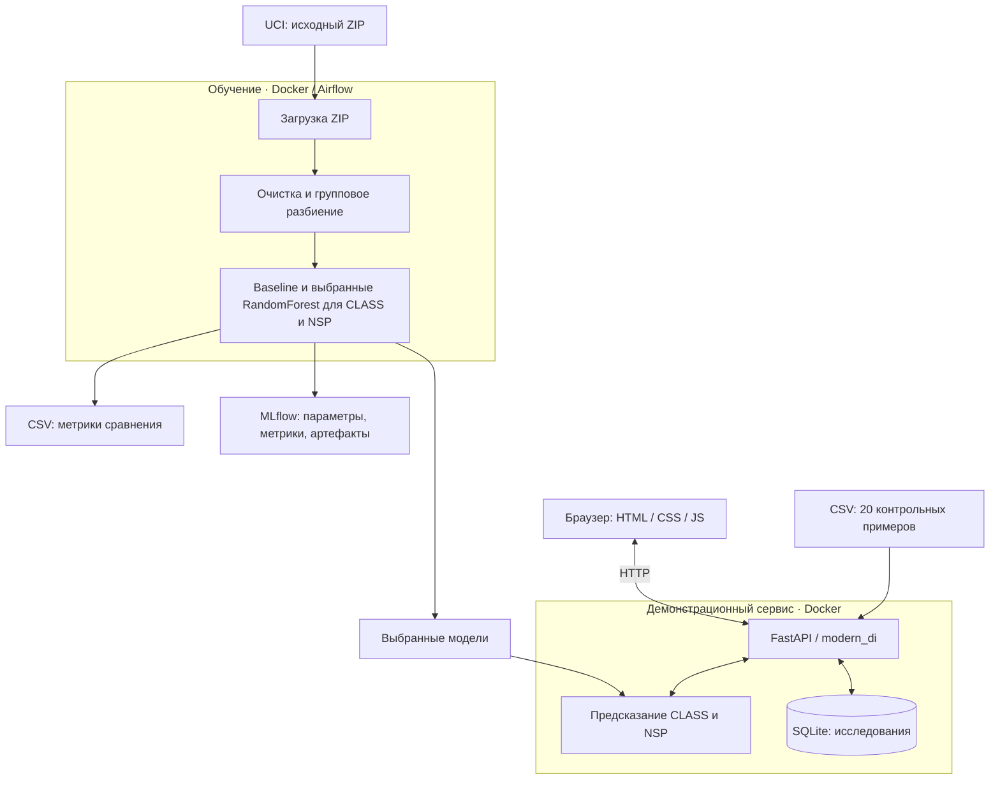

# CTG classifier demo

Учебный проект ML/DL: сервис классификации результатов кардиотокографии (КТГ). По 21 измерению две независимые модели определяют морфологический паттерн **CLASS** и категорию состояния **NSP**. Исследованы классические классификаторы и MLP; в сервисе используются оптимизированные RandomForest.

## Содержание

- [Задача и сценарий](#task)
- [Демонстрационный сервис](#demo)
- [Данные и исследования](#research)
- [Результаты до/после](#results)
- [Контрольный прогон](#controls)
- [Архитектура и структура](#architecture)
- [Установка и запуск](#start)
- [Конфигурация](#configuration)
- [API и интерфейс](#api)
- [Артефакты](#artifacts)

<a id="task"></a>
## Задача и сценарий

Пользователь — специалист, просматривающий исследования. Сервис поднимает подозрительные и патологические результаты в очереди для ручной проверки. Пропустить предупреждение хуже, чем создать лишнее, но ложные предупреждения увеличивают нагрузку.

Вход — измерения одного сегмента КТГ, выход — CLASS и NSP. Это учебная демонстрация на историческом датасете, без клинической проверки и подключения к медицинской системе. Предсказание не является диагнозом или решением о лечении.

### Требования

| Тип | Требование и критерий | Проверка / результат |
|---|---|---|
| Функции | API возвращает CLASS из 10 категорий и NSP из 3 категорий; GET /health отвечает 200 | Контракт Pydantic, HTTP-проверки и автотесты; выполнено |
| Функции | Все 20 контрольных примеров можно отправить, сохранить и открыть в карточке с 21 измерением | Контрольный прогон ниже: все POST — 201, все карточки — 200 |
| Функции | Сортировка по NSP: Pathologic → Suspect → Normal; истинные метки доступны по переключателю | Repository и проверка UI; выполнено |
| Функции | Записи сохраняются после перезапуска; удаление даёт 204, повторное чтение — 404 | Docker-проверка и автотесты; выполнено |
| Качество | CLASS: macro-F1 выбранной модели выше baseline на одинаковом test | 0,710 → 0,779; macro-precision при этом снизился |
| Качество | NSP: число Pathologic → Normal и Suspect → Normal не увеличивается относительно baseline | 1 → 0 и 13 → 8; ложные предупреждения выросли 17 → 28, macro-F1 снизился 0,833 → 0,820 |
| Качество | Нет пересечения FileName между выборками и целевой разметки во входах; scaler обучен только на train | Блокноты 02–04, схема данных и тест подготовки |
| Качество | Baseline и выбранные модели сравниваются на одном test по accuracy, precision, recall, F1 macro/weighted и confusion matrix | Блокноты, MLflow и отчёт пайплайна; выполнено |
| Качество | Повторное обучение с seed 42 и uv.lock воспроизводит результат в одной среде | Повторные прогоны совпали; межплатформенное отличие CLASS описано ниже |
| Безопасность | Некорректные/лишние поля и цели во features дают 422; неизвестный case_id — 404; конфигурация без секретов, логи без исходных измерений | Автотесты и проверка API/конфигурации; выполнено |
| Надёжность | API загружает готовые модели без обучения; сбой сохранения не возвращает успех | Lifespan и тест сбоя SQLite; отдельный протокол безопасного HTTP 500 ещё предстоит оформить |

<a id="demo"></a>
## Демонстрационный сервис

Пользователь отправляет контрольный пример. FastAPI предсказывает обе цели, сохраняет результат в SQLite и показывает запись в таблице. Истинные метки известны для сравнения, но не передаются моделям. Порядок по умолчанию: Pathologic → Suspect → Normal.

Входящий поток имитируется отправкой 20 примеров из test — по два каждого CLASS. Каждая отправка создаёт новый короткий ID. Контрольный набор проверяет сценарий сервиса, а не качество на полном test.

<a id="research"></a>
## Данные и исследования

Источник — [UCI Cardiotocography](https://archive.ics.uci.edu/dataset/193/cardiotocography), Campos & Bernardes (2000), DOI 10.24432/C51S4N, CC BY 4.0. Это реальные измерения. Используется исходный лист **Raw Data** файла CTG.xls; подготовленный лист Data не берётся за основу. CLASS — 10 паттернов; NSP — Normal, Suspect и Pathologic.

### 01 — Первичный EDA

[01_eda.ipynb](experiments/01_eda.ipynb): скачивание ZIP, извлечение XLS, словарь колонок, пропуски, дубликаты и проверка разметки. После удаления служебных строк, повторов и конфликтующих меток остаётся **2108 строк и 40 колонок**. Классы несбалансированы; редкие большие значения не удаляются автоматически. Очищенная таблица со всеми колонками сохраняется в `runtime/data/prepared/ctg_cleaned.csv`.

### 02 — Подготовка данных

[02_preparation.ipynb](experiments/02_preparation.ipynb): групповое разбиение примерно 60/20/20 — **1266 train, 421 validation, 421 test**. StratifiedGroupKFold использует FileName, стратификацию по CLASS и seed 42: сегменты одного исследования остаются вместе. Распределения, корреляции и выбор признаков исследуются на train.

LBE исключён как копия LB, DR — как постоянный признак, Width — как Max − Min. Вместо b/e добавлен `duration = e − b`. Индикаторы A–SUSP, цели и служебные поля удаляются из входов после группового разбиения. Сохраняются три CSV с 21 признаком и двумя целями:

`LB, AC, FM, UC, ASTV, MSTV, ALTV, MLTV, DL, DS, DP, Min, Max, Nmax, Nzeros, Mode, Mean, Median, Variance, Tendency, duration`.

Для части паттернов в train встречается несколько NSP, поэтому универсальное CLASS → NSP не применимо. Модели обучаются независимо: распознанный первой моделью FS не передаётся второй и не определяет её ответ.

### 03 — Классические модели

[03_classical_models.ipynb](experiments/03_classical_models.ipynb): DummyClassifier, LogisticRegression, LinearSVC и RandomForest сравниваются отдельно для каждой цели. Рабочий baseline — исходный RandomForest. StandardScaler обучается на train внутри sklearn Pipeline и применяется к validation/test.

Подбор параметров Optuna с TPE: **25 попыток на семейство и цель**, затем **50 попыток** уточнения RandomForest на цель. Выбор — по validation, итоговая оценка — на общем test. Эксперименты сохраняются в MLflow, выбранные модели — также локально.

### 04 — Нейросетевые модели

[04_neural_models.ipynb](experiments/04_neural_models.ipynb): небольшие MLP на PyTorch с Linear/ReLU, CrossEntropyLoss и Adam. Исследованы кривые обучения, веса классов, dropout, weight decay, learning rate и архитектуры. Scaler обучается только на train; ранняя остановка и выбор лучших весов используют validation macro-F1.

Обучены две исходные MLP и по 25 кандидатов на цель — **52 сети**. Лимиты — 50/150 эпох с ранней остановкой. На общем test macro-F1 MLP — 0,702 для CLASS и 0,708 для NSP (macOS): по общим метрикам они уступили RandomForest. В сервисе используются RandomForest, MLP сохранены как артефакты исследования.

<a id="results"></a>
## Результаты до/после

`just pipeline` заново обучает четыре RandomForest: baseline и выбранный вариант для CLASS и NSP. Метрики рассчитываются по предсказаниям на train/validation/test. CSV: `runtime/reports/trained_classifier_comparison_metrics.csv`. Ниже — сводка последнего запуска на test.

| Цель / вариант | Accuracy | Macro-precision | Macro-recall | Macro-F1 | Weighted-F1 |
|---|---:|---:|---:|---:|---:|
| CLASS baseline | 0,808 | 0,859 | 0,674 | 0,710 | 0,796 |
| CLASS выбранный | 0,822 | 0,777 | 0,792 | 0,779 | 0,823 |
| NSP baseline | 0,910 | 0,846 | 0,826 | 0,833 | 0,912 |
| NSP выбранный | 0,895 | 0,805 | 0,850 | 0,820 | 0,902 |

Для CLASS macro-F1 вырос, но macro-precision снизился. Для NSP выбран компромисс: Pathologic → Normal сократились с **1 до 0**, Suspect → Normal — с **13 до 8**, а ложные предупреждения выросли с **17 до 28**. Общие F1 и accuracy NSP не улучшились. Macro-F1 одинаково учитывает категории; weighted-F1 сильнее зависит от частых классов и служит дополнительной метрикой. Матрицы ошибок и отчёты по классам сохранены в блокнотах и MLflow.

Блокноты выполнялись на macOS; Airflow работает внутри Linux-контейнера Docker Desktop на том же Mac. Разные бинарные сборки библиотек округляют по-разному: выбранный RandomForest для CLASS отличается одним ответом из 421, macro-F1 — **0,7773 на macOS и 0,7793 в Linux**. Повторные прогоны внутри каждой среды совпали. 

<a id="controls"></a>
## Контрольный прогон

D01–D20 из [demo_cases.csv](src/classifier/api/resources/demo_cases.csv) проверены через POST /demo/records Docker-сервиса: отправки — 201, карточки — 200. Результат указан отдельно для NSP и CLASS. 

| Пример | Важность | Истинная важность | Результат NSP | Паттерн | Истинный паттерн | Результат CLASS | Возможная причина ошибки |
|---|---|---|---|---|---|---|---|
| D01 | Норма | Норма | Успех | C | A | Ошибка | Модель предпочла C (0,74) вместо A (0,15). Возможен похожий профиль измерений; ошибка уверенная, не пограничная. |
| D02 | Норма | Норма | Успех | B | B | Успех | — |
| D03 | Норма | Норма | Успех | C | C | Успех | — |
| D04 | Норма | Норма | Успех | D | D | Успех | — |
| D05 | Подозрительный | Подозрительный | Успех | E | E | Успех | — |
| D06 | Норма | Норма | Успех | AD | AD | Успех | — |
| D07 | Норма | Норма | Успех | DE | DE | Успех | — |
| D08 | Патологический | Патологический | Успех | LD | LD | Успех | — |
| D09 | Патологический | Подозрительный | Ошибка | FS | FS | Успех | Завышена важность, предупреждение сохранено. Оценки Pathologic=0,49 и Suspect=0,30. Возможно пересечение профилей измерений подозрительных и патологических записей. |
| D10 | Подозрительный | Подозрительный | Успех | SUSP | SUSP | Успех | — |
| D11 | Норма | Норма | Успех | A | A | Успех | — |
| D12 | Норма | Норма | Успех | B | B | Успех | — |
| D13 | Норма | Норма | Успех | C | C | Успех | — |
| D14 | Норма | Норма | Успех | B | D | Ошибка | Оценки B=0,55 и D=0,36. Возможное пересечение признаков; D представлен в train 48 записями, B — 345. |
| D15 | Подозрительный | Подозрительный | Успех | SUSP | E | Ошибка | Оценки SUSP=0,60 и E=0,23. E редкий в train: 43 записи против 117 SUSP; возможна недостаточная представленность такого профиля. |
| D16 | Норма | Норма | Успех | B | AD | Ошибка | Оценка B=0,80. Возможен профиль AD, близкий к B и недостаточно отражённый в train; одного дисбаланса недостаточно для объяснения. |
| D17 | Норма | Норма | Успех | A | DE | Ошибка | Оценка A=0,89. Вероятен плохо обобщённый профиль DE; высокая оценка модели не гарантирует правильности. |
| D18 | Патологический | Патологический | Успех | LD | LD | Успех | — |
| D19 | Подозрительный | Патологический | Ошибка: Патологический → Подозрительный | FS | FS | Успех | Важность занижена, но предупреждение осталось. Оценки Suspect=0,69 и Pathologic=0,30. Возможен профиль измерений, похожий на Suspect; отдельная модель CLASS при этом верно определила FS. |
| D20 | Подозрительный | Подозрительный | Успех | SUSP | SUSP | Успех | — |

### Выводы

- Обе метки верны у **13 из 20** исследований; CLASS — у **15 из 20**, NSP — у **18 из 20**.
- В D09 NSP завышен: Suspect → Pathologic. В D19 он занижен: Pathologic → Suspect, поэтому запись может оказаться ниже в очереди. Ошибок Suspect/Pathologic → Normal в этом наборе нет.
- Правильный CLASS не гарантирует правильного NSP: модели независимо используют измерения.

Набор содержит по два примера каждого CLASS и отобран из уже использованного test. Его результаты не заменяют итоговую оценку на 421 записи. Ошибки паттернов A, D, E, AD и DE показывают ограничения модели. Предположительно, причина ошибок в определении паттерна - недостаточная представленность некоторых классов в исходных данных, возможное изначальное сходство паттернов между собой и субъективность разметки (в исходных данных были идентичные строки, размеченные по-разному).

<a id="architecture"></a>
## Архитектура и структура



- `src/classifier/pipeline/` — DAG, загрузка, подготовка, обучение, схема данных и настройки.
- `src/classifier/api/` — HTTP-контракт, modern_di, ресурсы, repositories и use case отправки. Модели/CSV загружаются в lifespan один раз в AppCache; SQLite-соединение создаётся на запрос и закрывается DI.
- `src/classifier/frontend/` — страница, которую раздаёт FastAPI; отдельная сборка не нужна.
- `experiments/` — четыре блокнота и настройки экспериментов; `tests/` — автотесты компонентов и API.

<a id="start"></a>
## Установка и запуск

Для готового сервиса нужны just и запущенный Docker. Из корня клонированного репозитория:

```bash
just api
```

Команда собирает Dockerfile.api и запускает готовые модели из Git: страница — http://127.0.0.1:8001/, Swagger — http://127.0.0.1:8001/docs. Модели подключены только для чтения, SQLite сохраняется на хосте. Ctrl+C останавливает и удаляет контейнер. Обучение и MLflow для API не нужны.

Для разработки и повторного обучения дополнительно нужны uv и Python **3.14.7**:

```bash
just lock
just install
just pipeline
```

`just lock` обновляет uv.lock; `just install` ставит все группы зависимостей в отдельную .venv. Для установки уже зафиксированных версий достаточно `just install`. Системный Python не используется. `just pipeline` запускает локальный MLflow и Linux-контейнер Airflow: скачивает ZIP UCI, извлекает CTG.xls, готовит выборки, обучает baseline/выбранные RandomForest и сохраняет отчёт. **Предварительно скачивать архив не нужно.** Optuna и MLP при обычном запуске DAG не выполняются.

Airflow доступен на http://127.0.0.1:5003/ только во время пайплайна, MLflow — http://127.0.0.1:5001/. Контейнер Airflow удаляется после завершения, в том числе при ошибке. Данные, логи и модели остаются в runtime. После переобучения перезапустите API для загрузки новых моделей.

### Блокноты и проверки

```bash
just mlflow-start
just jupyter-start
just lint
just test
```

JupyterLab: http://127.0.0.1:5002/, ссылка с токеном — в runtime/jupyter/logs.log. Блокноты выполняются последовательно 01–04. Остановка: `just jupyter-stop`, `just mlflow-stop`. Последняя проверка — **15 тестов прошли**, Ruff и ty без ошибок; тесты используют временные данные и отдельную SQLite.

Группы зависимостей: `dev` — проверки; `data` — pandas/sklearn/xlrd; `neural` — PyTorch; `research` — Jupyter/графики/Optuna; `tracking` — MLflow; `orchestration` — Airflow; `service` — FastAPI/Uvicorn/modern_di и классические модели. API-образ устанавливает только service, локальная установка — все группы.

<a id="configuration"></a>
## Конфигурация

Justfile загружает [.env](.env) в окружение, pydantic-settings читает переменные с префиксами. В .env только публичные настройки, поэтому файл включён в Git. PIPELINE_ задаёт источник, пути и seed; RANDOM_FOREST_ — параметры baseline/CLASS/NSP; EXPERIMENT_ — настройки экспериментов и бюджеты Optuna; API_/SERVICE_ — адрес и пути сервиса; MLFLOW_ — адрес tracking-сервера. Пример вложенного поля: `RANDOM_FOREST_CLASS_PARAMETERS__MAX_DEPTH=12`.

Docker-образ Airflow использует MLFLOW_HOST=host.docker.internal, локальные эксперименты — 127.0.0.1 по умолчанию. API_HOST=0.0.0.0 нужен внутри контейнера; порт хоста публикуется только на 127.0.0.1. После изменения настроек перезапустите процесс; изменение параметров обучения требует повторного пайплайна.

<a id="api"></a>
## API и интерфейс

| Метод | Путь | Назначение |
|---|---|---|
| GET | `/health` | Проверка процесса |
| POST | `/predict` | CLASS и NSP по 21 полю features, без сохранения |
| GET | `/demo/cases` | Контрольные примеры с измерениями и истинными метками |
| POST | `/demo/records` | Отправить case_id, предсказать и сохранить |
| GET | `/records` | Список исследований |
| GET | `/records/{record_id}` | Карточка с измерениями |
| DELETE | `/records/{record_id}` | Удалить: 204; неизвестный ID — 404 |

```bash
curl http://127.0.0.1:8001/health
curl -X POST http://127.0.0.1:8001/demo/records \
  -H 'Content-Type: application/json' -d '{"case_id":"D01"}'
```

POST /predict принимает `{"features": {...}}`; полный пример — в Swagger. Ошибки валидации дают 422, неизвестный case_id — 404. Ответ содержит model=RandomForest и prediction.class/nsp с code/label. Сохранённая запись также содержит record_id, case_id, created_at и reference. Истинные метки скрываются только визуально; это публичные контрольные данные демо.

Таблица обновляется каждые 5 секунд, показывает ID, время, цветной NSP и паттерн. Зелёный — норма, жёлтый — подозрительный, красный — патологический. Переключатель показывает истинные метки и совпадения/ошибки отдельно для обеих целей. Измерения видны в карточке; Tendency отображается направлением смещения. Корзины в строке и карточке удаляют запись.

<a id="artifacts"></a>
## Артефакты

| Путь | Содержание | В Git |
|---|---|---|
| `runtime/data/raw/` | ZIP и CTG.xls | Нет |
| `runtime/data/prepared/` | Очищенные данные и train/validation/test | Нет |
| `runtime/models/classical/` | class/nsp.joblib и JSON с параметрами/метриками | Да |
| `runtime/models/neural/` | Веса MLP, JSON и scaler | Да |
| `runtime/reports/trained_classifier_comparison_metrics.csv` | Метрики baseline/selected | Нет |
| `runtime/mlflow/` | История экспериментов, артефакты, логи | Нет |
| `runtime/airflow/`, `runtime/jupyter/` | Служебные файлы и логи | Нет |
| `runtime/service/analyses.db` | Сохранённые исследования | Нет |

Готовые модели включены в Git для запуска без обучения. 
