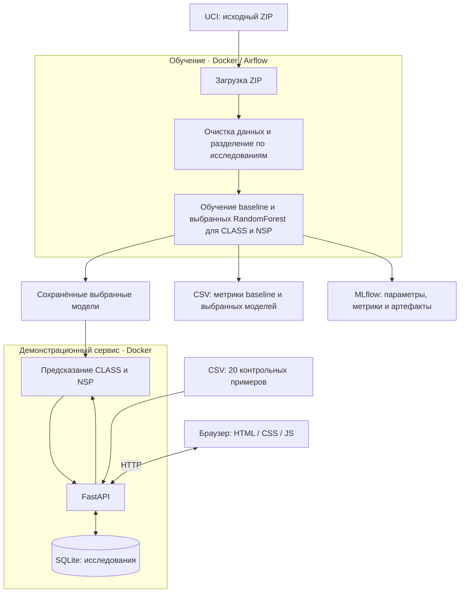

# CTG classifier demo

Учебный проект по траектории ML/DL: сервис классификации результатов кардиотокографии (КТГ). Модели определяют морфологический паттерн **CLASS** и категорию состояния **NSP** по 21 измерению. Исследованы классические классификаторы и MLP; для сервиса выбраны две независимые оптимизированные RandomForest.

## Задача и сценарий

Пользователь — специалист, просматривающий поступившие исследования. 
- Сервис помогает выделять подозрительные и патологические результаты для более ранней ручной проверки. 
- Важнее не пропустить подозрительные и патологические записи, хотя ложные предупреждения тоже увеличивают нагрузку.

## Демонстрационный сервис
Это учебная демонстрация на историческом датасете, без клинической проверки. 
- Пользователь отправляет один из фиксированных контрольных примеров. 
- Сервис получает измерения, предсказывает CLASS и NSP, сохраняет результат в SQLite и отображает его в таблице. 
- Сортировка по важности: патологические записи располагаются первыми, затем подозрительные и нормальные. 
- Истинные метки известны для сравнения и не передаются моделям.

## Данные и исследования

Источник — [UCI Cardiotocography](https://archive.ics.uci.edu/dataset/193/cardiotocography), Campos & Bernardes (2000), DOI 10.24432/C51S4N, лицензия CC BY 4.0. Это реальные измерения, не синтетические данные. Используется исходный лист **Raw Data** файла CTG.xls.


### [01_eda.ipynb](01_eda.ipynb): 

Загрузка Raw Data, словарь колонок, очистка, сводные отчёты и выводы первичного EDA. 

- CLASS содержит 10 паттернов 
- NSP — Normal, Suspect и Pathologic   

Обе колонки — целевые; их и индикаторы паттернов исключаем из входа. 
После очистки остаётся 2108 записей.  
В `ctg_cleaned.csv` сохраняются все колонки после очистки. 
Сохранение таблицы в `runtime/data/prepared/ctg_cleaned.csv`.

### [02_preparation.ipynb](02_preparation.ipynb): 

Разбиение примерно 60/20/20: **1266 train, 421 validation, 421 test**, seed 42. StratifiedGroupKFold учитывает CLASS и FileName, поэтому сегменты одного исходного исследования не попадают в разные части.

Исследование связи CLASS/NSP: CLASS не преобразуется автоматически в NSP: обучаются два отдельных классификатора.  
Определены входы: 
`LB, AC, FM, UC, ASTV, MSTV, ALTV, MLTV, DL, DS, DP, Min, Max, Nmax, Nzeros, Mode, Mean, Median, Variance, Tendency, duration`. 
duration вычисляется как e − b; идентификаторы и исключённые измерения удаляются при подготовке. StandardScaler обучается только на train внутри sklearn Pipeline.
Исследование train, duration и выбор входных признаков. Сохраняет три подготовленные выборки: 21 входной признак и две цели..

### [03_classical_models.ipynb](03_classical_models.ipynb): 
начальное сравнение, RandomForest baseline, два этапа Optuna, итоговая оценка и сохранение классических моделей.

### [04_neural_models.ipynb](04_neural_models.ipynb): 

обучение MLP, подбор параметров, сравнение с классическими моделями на test, выбор моделей для сервиса и сохранение нейросетей.

 Идентификаторы удаляются после группового разбиения; индикаторы паттернов исключаются. CLASS и NSP не подаются на вход модели.

### Результат исследования
Для сервиса выбраны оптимизированные RandomForest для обеих целей. 
Подготовка и обучение RandomForest реализованы в [Airflow-пайплайне](../src/classifier/pipeline/dag.py). 
Проверяемые требования и контрольный прогон приведены ниже.

Baseline — исходный RandomForest для каждой цели.  

Optuna настраивает три классических семейства: 25 попыток на семейство и цель, затем 50 попыток для уточнения выбранного семейства. Выбор производится по validation; test используется для итогового сравнения.  

MLP остаётся исследовательским сравнением, в API она не используется.

## Результаты до/после

При каждом запуске пайплайн заново обучает четыре RandomForest: baseline и выбранный вариант отдельно для CLASS и NSP. Для каждой модели рассчитываются метрики по её предсказаниям на train, validation и test; значения baseline не захардкожены и не берутся из старого отчёта. Таблица ниже — вручную записанная сводка последнего запуска.

Отчёт Airflow-пайплайна сохраняется в: `runtime/reports/trained_classifier_comparison_metrics.csv`. Все строки ниже относятся к **одним и тем же 421 записям test**.

| Цель / вариант | Accuracy | Macro-precision | Macro-recall | Macro-F1 | Weighted-F1 |
|---|---:|---:|---:|---:|---:|
| CLASS baseline | 0,808 | 0,859 | 0,674 | 0,710 | 0,796 |
| CLASS выбранный | 0,822 | 0,777 | 0,792 | 0,779 | 0,823 |
| NSP baseline | 0,910 | 0,846 | 0,826 | 0,833 | 0,912 |
| NSP выбранный | 0,895 | 0,805 | 0,850 | 0,820 | 0,902 |

Для CLASS macro-F1 вырос, но macro-precision снизился. 
Для NSP общие F1 и accuracy не улучшились. 
В исследовательском сравнении ошибки 
- Pathologic → Normal сократились с 1 до 0, 
- Suspect → Normal — с 13 до 8; 
- Ложные предупреждения Normal → Suspect/Pathologic выросли с 17 до 28. 
Выбранный вариант NSP отражает приоритет обнаружения предупреждений.

Macro-F1 одинаково учитывает категории.  
Weighted-F1 сильнее зависит от частых классов и служит дополнительной метрикой: он не должен скрывать пропуски редких патологических результатов.  
Матрицы ошибок и метрики отдельных классов сохранены в блокнотах и MLflow.

Блокноты выполнялись непосредственно на macOS. Airflow-пайплайн работает в Docker-контейнере на базе python:3.14.7-slim — внутри него Linux, даже при запуске Docker Desktop на Mac. Из-за разных бинарных сборок библиотек математически равные Gini-разбиения округляются по-разному; выбранный CLASS-лес отличается одним ответом из 421 (macro-F1 0,7773 в блокноте и 0,7793 в контейнере). Повторные запуски в каждой среде воспроизводят её результат.


## Прогон 20 контрольных исследований

Отправлены все примеры D01–D20 из [demo_cases.csv](../src/classifier/api/resources/demo_cases.csv) через POST /demo/records работающего Docker-сервиса. Для каждого запроса получен HTTP 201. В таблице примеры обозначены идентификаторами D01–D20 из контрольного CSV.

Результат указан отдельно для NSP и CLASS: «Успех» — совпадение с истинной меткой, «Ошибка» — несовпадение. HTTP-запрос при этом выполнен успешно. Описанные причины ошибок — гипотезы по оценкам модели и составу train, а не установленная причина. Числа вида 0,74 — оценки predict_proba RandomForest, не клиническая вероятность и не доля деревьев.

| Пример | Важность | Истинная важность | Результат NSP | Паттерн | Истинный паттерн | Результат CLASS | Возможная причина ошибки |
|---|---|---|---|---|---|---|---|
| D01 | Норма | Норма | Успех | C | A | Ошибка: A → C | Модель предпочла C (0,74) вместо A (0,15). Возможен похожий профиль измерений; ошибка уверенная, не пограничная. |
| D02 | Норма | Норма | Успех | B | B | Успех | — |
| D03 | Норма | Норма | Успех | C | C | Успех | — |
| D04 | Норма | Норма | Успех | D | D | Успех | — |
| D05 | Подозрительный | Подозрительный | Успех | E | E | Успех | — |
| D06 | Норма | Норма | Успех | AD | AD | Успех | — |
| D07 | Норма | Норма | Успех | DE | DE | Успех | — |
| D08 | Патологический | Патологический | Успех | LD | LD | Успех | — |
| D09 | Патологический | Подозрительный | Ошибка: Подозрительный → Патологический | FS | FS | Успех | Завышена важность, предупреждение сохранено. Оценки Pathologic=0,49 и Suspect=0,30. Возможно пересечение профилей измерений подозрительных и патологических записей; CLASS не используется моделью NSP как вход. |
| D10 | Подозрительный | Подозрительный | Успех | SUSP | SUSP | Успех | — |
| D11 | Норма | Норма | Успех | A | A | Успех | — |
| D12 | Норма | Норма | Успех | B | B | Успех | — |
| D13 | Норма | Норма | Успех | C | C | Успех | — |
| D14 | Норма | Норма | Успех | B | D | Ошибка: D → B | Оценки B=0,55 и D=0,36. Возможное пересечение признаков; D представлен в train 48 записями, B — 345. |
| D15 | Подозрительный | Подозрительный | Успех | SUSP | E | Ошибка: E → SUSP | Оценки SUSP=0,60 и E=0,23. E редкий в train: 43 записи против 117 SUSP; возможна недостаточная представленность такого профиля. |
| D16 | Норма | Норма | Успех | B | AD | Ошибка: AD → B | Оценка B=0,80. Возможен профиль AD, близкий к B и недостаточно отражённый в train; одного дисбаланса недостаточно для объяснения. |
| D17 | Норма | Норма | Успех | A | DE | Ошибка: DE → A | Оценка A=0,89. Вероятен плохо обобщённый профиль DE; высокая оценка модели не гарантирует правильности. |
| D18 | Патологический | Патологический | Успех | LD | LD | Успех | — |
| D19 | Подозрительный | Патологический | Ошибка: Патологический → Подозрительный | FS | FS | Успех | Важность занижена, но предупреждение осталось. Оценки Suspect=0,69 и Pathologic=0,30. Возможен профиль измерений, похожий на Suspect; отдельная модель CLASS при этом верно определила FS. |
| D20 | Подозрительный | Подозрительный | Успех | SUSP | SUSP | Успех | — |

### Выводы по контрольному прогону

- Все 20 запросов обработаны и сохранены. Проверка сохранённых записей и карточек проводится через API; ошибка предсказания не означает ошибку работы endpoint.
- Обе метки верны у 13 из 20 исследований. CLASS верен у 15 из 20, NSP — у 18 из 20.
- В D09 важность завышена: дополнительная ручная проверка. В D19 Pathologic ошибочно отнесён к Suspect: предупреждение осталось, но такой результат может отодвинуть патологическое исследование ниже в очереди.
- Suspect/Pathologic → Normal в этом наборе нет. Это не доказывает отсутствие таких ошибок на других данных: оценка полного test приведена отдельно.
- Ошибки паттернов A, D, E, AD и DE показывают ограничения классификатора. Дисбаланс может объяснять часть ошибок редких категорий, но D01/D16/D17 ошибочны и при высокой оценке выбранного класса; нужны более подробный разбор признаков и независимые данные, чтобы установить причину.

Набор содержит по два примера каждого CLASS и предназначен для проверки демонстрационного сценария. Это часть уже использованного test, а не отдельная независимая выборка. 

## Архитектура



- `src/classifier/pipeline/`: DAG, загрузка, подготовка, обучение, схема данных и настройки.
- `src/classifier/api/`: FastAPI, модели HTTP-контракта, зависимости, ресурсы, repositories и use case отправки.
- `src/classifier/frontend/`: страница без отдельной сборки, раздаётся FastAPI.
- `experiments/`: четыре блокнота и настройки экспериментов.
- `tests/`: тесты подготовки, предсказания, API и отчёты проверок.

## Установка и запуск

Для запуска готового сервиса нужны just и Docker. Для локальной разработки и блокнотов дополнительно нужны Python **3.14.7** и uv. 
Версия Python закреплена в `.python-version`, `pyproject.toml` и Dockerfile.airflow. 
Все команды выполняются из корня проекта.

Для запуска демонстрационного сервиса готовые модели уже находятся в репозитории:

```bash
just api
```

Для разработки и повторного обучения:

```bash
just lock
just install
just pipeline
just api
```

ZIP не нужно скачивать вручную. Первая задача DAG download_dataset сама получает архив UCI и сохраняет его в runtime/data/raw/cardiotocography.zip. Следующая задача извлекает CTG.xls и готовит данные, последняя — обучает модели и формирует отчёт.

`just lock` обновляет lock-файл; 
`just install` устанавливает все группы в отдельную `.venv` из uv.lock. Системный Python не используется. 
`just pipeline` запускает MLflow, собирает контейнер Airflow, скачивает данные, готовит выборки и обучает baseline и выбранные RandomForest. Контейнер Airflow удаляется после завершения, результаты остаются в runtime.

`just api` собирает Dockerfile.api и запускает контейнер в текущем терминале; после остановки контейнер удаляется. Исходники и frontend находятся внутри образа, готовые модели подключаются только для чтения, SQLite сохраняется в runtime/service на хосте. В репозитории сохранены class.joblib и nsp.joblib. Если они удалены, восстановите их из Git либо выполните just pipeline. При отсутствии моделей запуск завершается ошибкой.

- Demo-страница: http://127.0.0.1:8001/
- Swagger: http://127.0.0.1:8001/docs
- MLflow: http://127.0.0.1:5001/
- Airflow: http://127.0.0.1:5003/ — только во время работы пайплайна.

API устанавливается в чистую среду Linux из uv.lock: только группа service.

### Исследование и проверки

```bash
just mlflow-start
just jupyter-start
just lint
just test
```

JupyterLab запускается на http://127.0.0.1:5002/. 
Блокноты выполняются последовательно 01–04. 
Остановка инструментов: `just jupyter-stop`, `just mlflow-stop`. 
Последняя проверка: **15 тестов прошли**, Ruff и ty без ошибок. Тесты используют отдельную временную базу.

Группы зависимостей: 
- `dev` — проверки; 
- `data` — pandas/sklearn/xlrd; 
- `neural` — PyTorch; 
- `research` — Jupyter, графики, Optuna; 
- `tracking` — MLflow; 
- `orchestration` — Airflow; 
- `service` — FastAPI/Uvicorn/modern_di и классические модели. 
Локальная установка включает все группы.

## Конфигурация

Justfile загружает `.env` в окружение. Pydantic-settings читает окружение с префиксами. В текущем файле только публичные настройки, секретов нет, поэтому .env добавлен в репозиторий.

После изменения настроек перезапустите соответствующий процесс.  
После изменения модели для обучения повторно запустите пайплайн.  

## API и интерфейс

| Метод | Путь | Назначение |
|---|---|---|
| GET | `/health` | Проверка процесса |
| POST | `/predict` | Два предсказания по features, без сохранения |
| GET | `/demo/cases` | 20 контрольных примеров с измерениями и истинными метками |
| POST | `/demo/records` | Отправить case_id, предсказать и сохранить исследование |
| GET | `/records` | Список сохранённых исследований |
| GET | `/records/{record_id}` | Карточка исследования |
| DELETE | `/records/{record_id}` | Удалить запись: 204, неизвестный ID: 404 |

Полный контракт и пример доступны в Swagger.

```bash
curl http://127.0.0.1:8001/health
```

POST /predict принимает `{"features": {...}}` со всеми 21 полями из списка входов выше. 
- Ошибки валидации отклоняются с 422; неизвестный контрольный пример — 404. 
- Ответ содержит model=RandomForest и prediction с объектами class/nsp, каждый с code и label. 
- Для сохранённых исследований добавляются record_id, case_id, created_at и reference. 
- Истинные ответы находятся в ответе API (для демо-проекта); переключатель скрывает их только визуально.

UI:
Таблица показывает ID, время, цветной NSP и паттерн, обновляется каждые 5 секунд. Зелёный — норма, жёлтый — подозрительный, красный — патологический. При показе истинных меток совпадения и ошибки отмечаются отдельно для обеих целей. Все измерения находятся в карточке. Повторная отправка примера создаёт новый короткий ID.

Контрольные данные: `src/classifier/api/resources/demo_cases.csv`, два примера каждого CLASS из test. Это набор для демонстрации, не самостоятельная оценочная выборка.

## Артефакты

В Git включены только готовые артефакты в runtime/models/. Это позволяет запускать сервис без предварительного обучения.

Остальные генерируемые файлы в runtime/ исключены из Git:

| Путь | Содержание | В Git |
|---|---|---|
| `runtime/data/raw/` | ZIP и CTG.xls | Нет |
| `runtime/data/prepared/` | Очищенные данные, train/validation/test | Нет |
| `runtime/models/classical/` | class/nsp.joblib, JSON с параметрами и метриками | Да |
| `runtime/models/neural/` | Экспорт MLP из исследований | Да |
| `runtime/reports/trained_classifier_comparison_metrics.csv` | Метрики baseline/selected по трём частям | Нет |
| `runtime/mlflow/` | База, артефакты и логи | Нет |
| `runtime/airflow/` | База и логи оркестратора | Нет |
| `runtime/jupyter/` | Лог и служебные файлы Jupyter | Нет |
| `runtime/service/analyses.db` | Сохранённые исследования | Нет |

Для сдачи остались таблица критериев, протокол контрольных сценариев, подтверждение развёртывания, презентация на 7–10 слайдов, портфолио и проверка доступности артефактов. `.env.example`, требуемый заданием, пока отсутствует по принятому решению хранить публичные настройки в `.env`.

